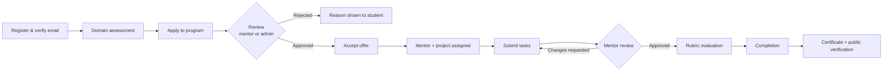
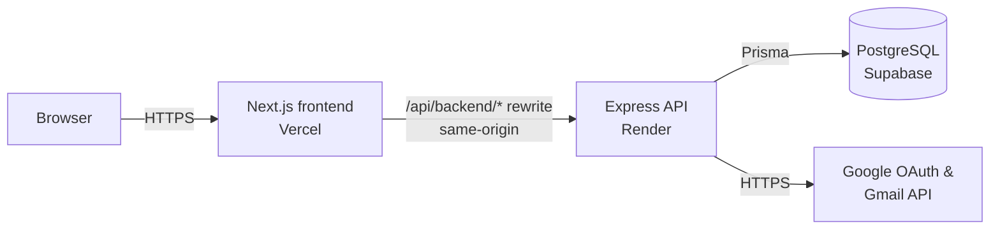

<div align="center">


# InternPath

**Project-based technical internships, run end to end: assessed, mentored, reviewed and verifiably certified.**

[](https://nextjs.org/)
[](https://react.dev/)
[](https://www.typescriptlang.org/)
[](https://expressjs.com/)
[](https://www.prisma.io/)
[](https://supabase.com/)

[**Live demo**](https://internpath-project.vercel.app) · [Features](#features) · [Architecture](#architecture) · [Getting started](#getting-started) · [Deployment](#deployment)

</div>

---

## Overview

InternPath is a web platform for running **structured, mentor-supervised, project-based technical internships** from first sign-up to a certificate anyone can verify.

Students register for free, take a timed skills assessment in a technical domain and apply to open programs that match their level. Accepted students build a real project under a dedicated mentor. They submit work as linked repositories, documents and demos, receive structured feedback and revise until every milestone is approved. Administrators run the catalogue, match mentors to interns, oversee evaluation and issue certificates whose authenticity can be checked publicly.

> Internships on InternPath are unpaid learning engagements. The platform charges students nothing, takes no commission and never handles payments between parties. The in-app participation policy states exactly what is and is not charged.

## Features

### For students
- **Skills assessment.** Timed, domain-specific assessments with server-side answer keys. The result level decides program eligibility.
- **Program discovery and applications.** Browse open programs, apply with a statement of interest, and track every status change with the reviewer's reason.
- **Offers.** Accept or decline an approved offer within the acceptance window.
- **Internship workspace.** Milestones and tasks with due dates and prerequisites, link-based submissions (repository, document, live demo) and an originality declaration.
- **Feedback loop.** Mentor reviews with "changes requested" comments, versioned resubmissions and live progress.
- **Certificates.** Download completion certificates as PDF and share a public verification number.

### For mentors
- **Application review.** Review applications in your own expertise domains: statement, academic profile and per-skill assessment scores, then approve or reject with a reason.
- **Review queue.** One entry per pending submission, oldest first, with waiting time and review-target flags.
- **Task review.** Approve, request changes, reopen with a justification, or adjust a due date with a recorded reason.
- **Project authoring.** Create project briefs with milestones, tasks, evidence types and dependencies (checked for cycles), then submit them for admin review.
- **Final evaluation.** Score every criterion of a weighted rubric and make a completion recommendation.

### For administrators
- **People.** Create mentor and admin accounts with single-use temporary passwords, suspend or reinstate accounts, change roles and run assisted password resets.
- **Catalogue.** Manage domains, skills, the assessment question bank and programs (draft → open → closed → archived).
- **Intake.** Review applications across all domains, with seat limits and mentor-capacity safeguards enforced on approval.
- **Operations.** Assign mentors and projects, activate, extend, terminate and complete internships, and issue or revoke certificates.
- **Governance.** Platform settings (each change requires a reason), report triage and a searchable audit log of sensitive actions.

### For everyone
- **Public certificate verification.** Confirms validity or revocation without exposing contact details or scores.
- **Notifications.** In-app notifications for decisions, reviews and assignments.
- **Problem reports.** Signed-in users can raise concerns that go straight to administrators.

## Workflow



## Architecture



The frontend calls the API through a same-origin rewrite (`/api/backend/*`), so session cookies stay first-party and no cross-origin requests are needed. The API is the single authority for access control. Every route checks the session and the role on the server, and the UI only reflects what the API allows.

### Technology

| Layer | Technology |
| --- | --- |
| Frontend | Next.js 15 (App Router), React 19, TypeScript, Tailwind CSS 4 |
| Backend | Node.js 22, Express 5, TypeScript |
| Database | PostgreSQL (Supabase) with Prisma 5 ORM and versioned migrations |
| Validation | Zod schemas on every request body, query and route parameter |
| Auth | Server-side sessions (HttpOnly cookies), bcrypt, Google OAuth 2.0 |
| Email | Gmail API over HTTPS or SMTP (verification and password-reset codes) |
| Documents | PDFKit (certificate PDFs) |
| Hosting | Vercel (frontend), Render (API), Supabase (database) |

### Security

- **Sessions.** Opaque, hashed session tokens in HttpOnly, `SameSite=Lax` cookies, with sliding inactivity expiry.
- **Passwords.** bcrypt hashing, a configurable minimum length, and single-use, expiring temporary passwords for admin-created accounts.
- **Email ownership.** 6-digit codes stored only as HMACs. They expire, work once, allow limited attempts and have a resend cooldown.
- **Google OAuth.** A single-use state bound to the initiating browser, plus audience, issuer and verified-email checks.
- **Abuse protection.** A global rate limiter plus a per-account failed-login limiter. Responses never reveal whether an account exists.
- **Hardening.** Helmet security headers on the API, strict input validation and a Content Security Policy on the frontend (currently in report-only mode).
- **Accountability.** Audit log entries for role changes, suspensions, decisions, settings changes and certificate events.

## Project structure

```
InternPath/
├── backend/                      Express API
│   ├── prisma/
│   │   ├── schema.prisma         Data model
│   │   ├── migrations/           Versioned SQL migrations
│   │   └── seed.ts               Demo data (blocked in production by default)
│   └── src/
│       ├── modules/              Feature modules: auth, profiles, domains, skills,
│       │                         assessment, programs, applications, projects,
│       │                         internships, certificates, notifications,
│       │                         reports, resources, admin
│       ├── shared/               Config, middleware, Prisma client, email, utilities
│       ├── app.ts                Express app and route mounting
│       └── server.ts             Entry point (applies pending migrations on Render)
├── frontend/                     Next.js App Router
│   └── src/
│       ├── app/
│       │   ├── (app)/
│       │   │   ├── (student)/    Student-only pages
│       │   │   ├── (mentor)/     Mentor-only pages  → /mentor/*
│       │   │   ├── (admin)/      Admin-only pages   → /admin/*
│       │   │   └── …             Shared signed-in pages (dashboard, profile, …)
│       │   └── …                 Public pages (landing, auth, verify, policy)
│       ├── components/
│       │   ├── student/  mentor/  admin/    Role-specific views
│       │   └── …                 Shared UI system and shells
│       ├── lib/                  API client, auth context, formatting, status maps
│       ├── styles/               Design tokens (Tailwind CSS 4 @theme)
│       └── types/                Shared TypeScript types
├── render.yaml                   Render blueprint for the API
└── package.json                  npm workspaces root (backend, frontend)
```

Route groups such as `(student)` organise files by role without changing URLs.

## Getting started

### Prerequisites

- **Node.js 20+** (22 recommended) and **npm 10+**
- A **PostgreSQL** database. A free [Supabase](https://supabase.com/) project works.

### 1. Install

```bash
git clone https://github.com/Kashyap136/InternPath.git
cd InternPath
npm install
```

Dependencies are managed with **npm workspaces**. Always install from the repository root so the single `package-lock.json` stays authoritative.

### 2. Configure

```bash
cp backend/.env.example backend/.env
cp frontend/.env.example frontend/.env.local
```

Edit `backend/.env` at minimum:

| Variable | Purpose |
| --- | --- |
| `DATABASE_URL` | PostgreSQL connection string |
| `JWT_SECRET`, `COOKIE_SECRET` | Long random secrets |
| `FRONTEND_URL` | Frontend origin, e.g. `http://localhost:3000` |
| `GOOGLE_CLIENT_ID`, `GOOGLE_CLIENT_SECRET` | *Optional.* Enables "Continue with Google" |
| `GMAIL_REFRESH_TOKEN` or `SMTP_*`, plus `EMAIL_FROM` | *Optional.* Sends verification and reset codes |

Without an email transport, development builds print verification codes to the API console. `backend/.env.example` documents every variable, including how to obtain a Gmail API token and the Google OAuth redirect URI.

### 3. Prepare the database

```bash
npm run db:generate          # Generate the Prisma client
npm run db:migrate:deploy    # Apply all migrations
npm run db:seed              # Optional: demo accounts and catalogue
```

The seed creates admin, mentor and student demo accounts plus a sample catalogue. Set their passwords with `DEMO_ADMIN_PASSWORD`, `DEMO_MENTOR_PASSWORD` and `DEMO_STUDENT_PASSWORD`. Seeding is refused when `NODE_ENV=production` unless explicitly overridden.

### 4. Run

```bash
npm run dev:backend      # API on http://localhost:4000
npm run dev:frontend     # Web on http://localhost:3000
```

> On Windows, run the two commands in separate terminals. The combined `npm run dev` cannot keep both watchers alive in one shell.

## Scripts

| Command | Description |
| --- | --- |
| `npm run dev:backend` / `dev:frontend` | Start the API or the web app in watch mode |
| `npm run build` | Build the API and the web app |
| `npm run typecheck` | Type-check both workspaces |
| `npm run lint` | Lint both workspaces |
| `npm run db:migrate:deploy` | Apply pending migrations |
| `npm run db:seed` | Seed demo data |
| `npm run db:studio` | Open Prisma Studio |

## Deployment

| Component | Platform | Notes |
| --- | --- | --- |
| Web app | **Vercel** | Set `NEXT_PUBLIC_API_URL` to the API origin. The `/api/backend/*` rewrite proxies to it. |
| API | **Render** | Defined in [`render.yaml`](render.yaml). Pending Prisma migrations are applied automatically on start. |
| Database | **Supabase** | Use the session-pooler connection string (IPv4) for `DATABASE_URL`. |

Before going live:
- Set `NODE_ENV=production`. The API then refuses to start with unsafe settings, such as a non-HTTPS `FRONTEND_URL` or a development database.
- Generate strong `JWT_SECRET` and `COOKIE_SECRET` values. Render can generate them for you.
- Add `https://<your-frontend>/api/backend/api/auth/google/callback` as an authorised redirect URI in Google Cloud if Google sign-in is enabled.
- Configure an email transport so students can verify their address and reset passwords. Render's free plan blocks SMTP ports, so use the Gmail API there.

## Roadmap

- Appreciation certificates alongside completion certificates (currently limited to one certificate per internship by the data model)
- Admin-editable evaluation rubrics (a default weighted rubric ships with the migrations)
- Configurable re-application policy for programs

## Contributing

InternPath is privately maintained. To propose a change:

1. Create a feature branch from `main`.
2. Keep `npm run typecheck` and `npm run lint` clean.
3. Add a Prisma migration for any schema change. Never edit an applied migration.
4. Open a pull request describing the change and how it was tested.

## License

Copyright © 2026 InternPath. All rights reserved.

This repository is proprietary. No licence is granted to use, copy, modify or distribute the software without written permission from the maintainers.
